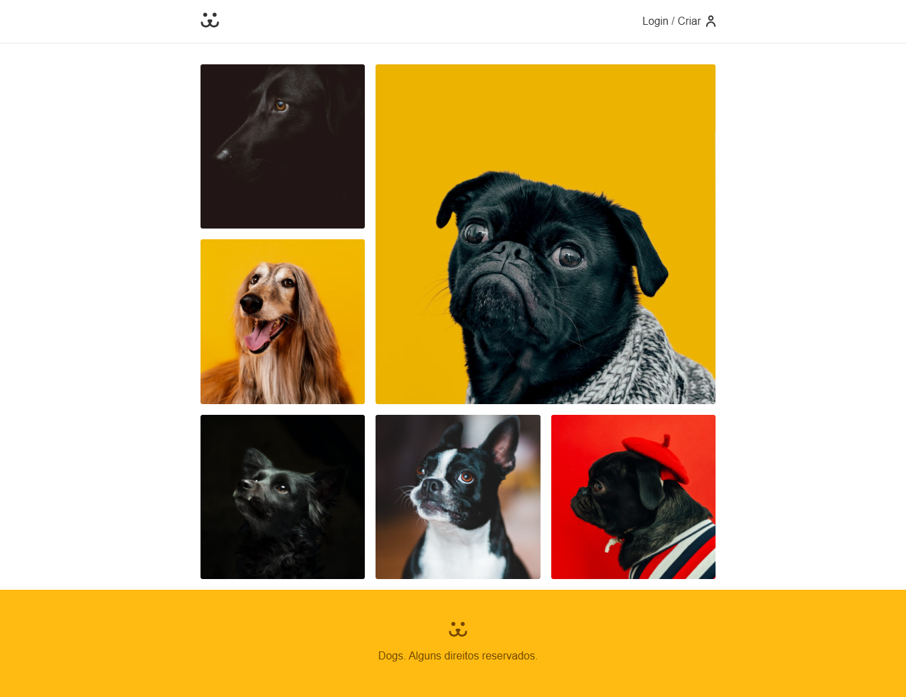

# 🐶 Dogs — Rede Social para Cachorros

Aplicação web de uma rede social para cachorros, desenvolvida com React durante o curso da Origamid e integrada a uma API REST própria, construída com Node.js, Express e MongoDB.

O projeto permite compartilhar fotos, interagir com publicações, visualizar estatísticas e gerenciar uma conta de usuário.



## 🚀 Sobre o Projeto

O Dogs é uma aplicação web que simula uma rede social voltada para cachorros.

O frontend foi desenvolvido com base no curso de React da Origamid. Como forma de aprofundar meus conhecimentos em desenvolvimento full stack, implementei uma API própria para substituir a API disponibilizada originalmente pelo curso.

A aplicação conta com autenticação, publicação de fotos, comentários, perfis públicos e estatísticas de visualizações.

## 🛠️ Tecnologias Utilizadas

- React
- JavaScript
- React Router DOM
- CSS Modules
- Victory (gráficos)
- Fetch API
- Vite

## ✨ Funcionalidades

- Cadastro e autenticação de usuários
- Login com JWT
- Recuperação e redefinição de senha por e-mail
- Publicação de fotos de cachorros
- Exclusão de fotos próprias
- Feed com paginação e carregamento infinito
- Visualização de detalhes das publicações
- Comentários nas fotos
- Contagem de visualizações
- Estatísticas de publicações com gráficos
- Perfis públicos de usuários
- Layout responsivo

## 📸 Demonstração

**Aplicação online:** [Adicionar link após o deploy]

**API utilizada:** [Adicionar link do repositório backend]

## 📂 Estrutura do Projeto

A aplicação está organizada em componentes React, páginas, hooks personalizados, contextos e arquivos de estilos.

Entre os recursos utilizados estão:

- **Context API:** gerenciamento do estado de autenticação.
- **React Router:** navegação entre páginas.
- **Hooks personalizados:** reutilização de lógica e validação de formulários.
- **CSS Modules:** organização dos estilos dos componentes.
- **Fetch API:** comunicação com o backend.

## ⚙️ Como Executar o Projeto

### Pré-requisitos

- Node.js
- npm
- API Dogs em execução

### Instalação

Clone o repositório:

```bash
git clone https://github.com/giosantos99/dogs.git
```

Acesse a pasta:

```bash
cd dogs
```

Instale as dependências:

```bash
npm install
```

Inicie o projeto:

```bash
npm run dev
```

Acesse o endereço informado pelo Vite no terminal.

## 🔗 Integração com a API

O frontend consome uma API REST própria desenvolvida com Node.js, Express e MongoDB.

A comunicação inclui autenticação JWT, gerenciamento de usuários, publicações, comentários e estatísticas.

**Observação:** antes de executar a aplicação, configure o endereço da API conforme o ambiente local ou de produção.

**Repositório backend:** [Link API](https://github.com/giosantos99/dogs-api.git)

## 📚 Créditos

Projeto frontend desenvolvido com base no curso de React da [Origamid](https://www.origamid.com/).

A API REST utilizada na integração foi desenvolvida como projeto de estudo independente, com foco na prática de desenvolvimento backend.

## 👩‍💻 Autoria

Desenvolvido por Giovanna Santos de Souza.

Projeto para fins de estudo e portfólio.

